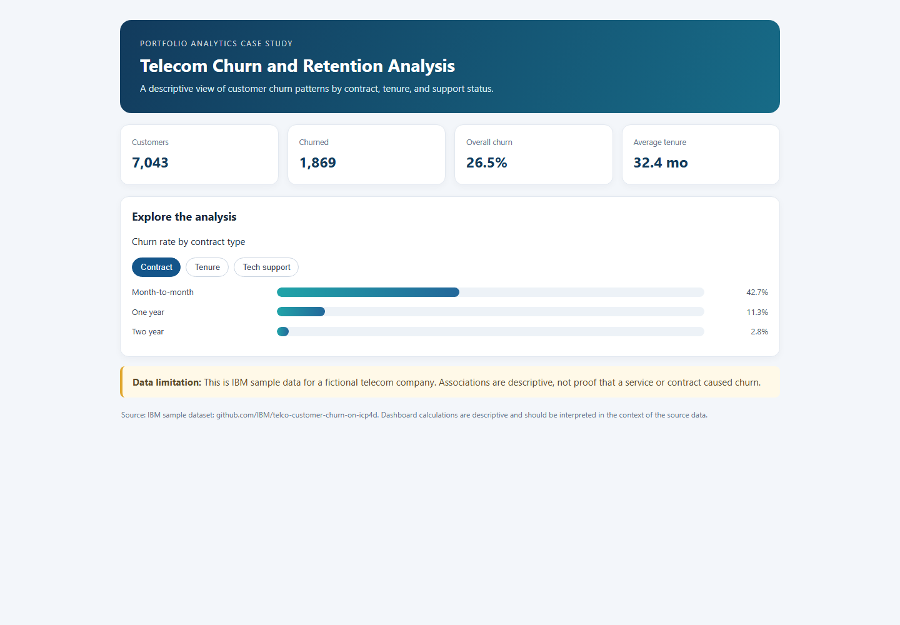

# Telecom Churn and Retention Analysis

## Project summary
A telecom retention team wants to understand which customer groups show higher churn so it can decide where to investigate onboarding, contract choice, and support experience. This case study uses IBM sample data for a **fictional** telecom provider.

## Business questions
1. What is the overall churn rate in the sample?
2. How does churn vary by contract type and customer tenure?
3. How does churn vary by technical support status?
4. Which customer segments might a retention team investigate further?

## Dataset
`Telco-Customer-Churn.csv` — 7,043 customer records and 21 columns. Source: [IBM sample dataset](https://github.com/IBM/telco-customer-churn-on-icp4d/blob/master/data/Telco-Customer-Churn.csv).

## Key findings
- 1,869 of 7,043 customers are marked as churned: **26.5% overall**.
- Observed churn is **42.7%** for month-to-month customers and **2.8%** for two-year customers.
- Customers with 0–12 months of tenure have **47.4%** observed churn.

## Dashboard

[Open the interactive dashboard](https://nilesh581.github.io/telecom-churn-retention-analysis/dashboard.html). Click the tabs to compare churn by contract, tenure, and technical support. The dashboard is self-contained; the source file is `dashboard.html`.

## Methods and limitations
The included Python script uses pandas to prepare the data and calculate segment-level churn rates. These are descriptive associations in a fictional sample; they do not show that contract type, tenure, or support causes churn. The data does not measure the impact of retention interventions.

## Resume bullet
Analyzed 7,043 IBM sample telecom records with Python and pandas; compared churn across contract, tenure, and support segments and built an interactive dashboard highlighting observed differences, including 42.7% churn for month-to-month versus 2.8% for two-year customers.

## Rebuild the dashboard
Install the dependencies with `python -m pip install pandas openpyxl`, then run `python build_dashboard.py` from this folder. The script reads the included dataset and regenerates `dashboard.html`. (The churn and bank projects only require pandas; openpyxl is needed for the retail Excel dataset.)
